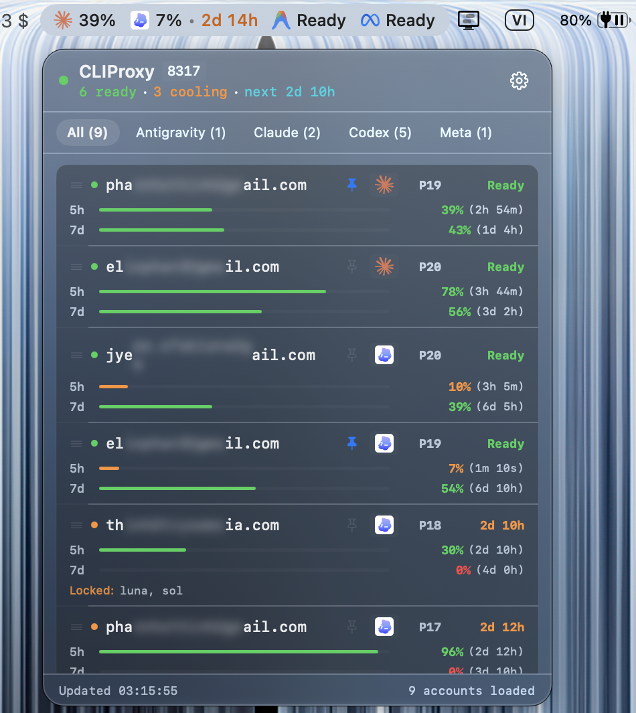

# CLIProxyBar

A native macOS menu bar utility for monitoring [CLIProxyAPI](https://github.com/router-for-me/CLIProxyAPI) accounts, quotas, and cooldowns.

<p align="center">
  
</p>

## Features

- **Menu Bar Glance**: Displays pinned accounts grouped by provider. Automatically adapts contrast to macOS Light and Dark appearance using Apple San Francisco tabular digits (`.SFNS-Medium`).
- **Live Cooldown Countdown**: Real-time remaining cooldown countdown (`2d 10h`, `15m 30s`) updating every second.
- **Provider Support**: Built-in vector branding for Anthropic (Claude), OpenAI (Codex), Google (Gemini, Antigravity), Qwen, DeepSeek, Grok, Kimi, and OpenAI-compatible endpoints.
- **Priority Reordering**: Drag and drop accounts in the list to update routing priority directly via API.
- **Privacy Mode**: Click-to-reveal email masking during screen sharing.
- **Preferences & Security**: Custom proxy URL and management secret stored securely in macOS Keychain.
- **Native & Lightweight**: Pure Swift/SwiftUI and AppKit with zero external dependencies and near-zero idle CPU usage.

## Requirements

- macOS 13.0 (Ventura) or later
- Xcode Command Line Tools (`xcode-select --install`)
- A running CLIProxyAPI instance

## Build & Install

```bash
git clone https://github.com/phannhothinh/CLIProxyBar.git
cd CLIProxyBar
./build.sh
open CLIProxyBar.app
```

The build script compiles optimized arm64 binaries and packages all vector assets into `CLIProxyBar.app`.

## Configuration

1. Click the menu bar item and open **Settings**.
2. Set the **Proxy URL** (default: `http://localhost:8317`) and **Management Secret Key**.
3. Choose a polling interval (1s to 30s).
4. Click the pin icon next to any account to track it directly in the menu bar.

## Project Structure

- `App.swift`: App lifecycle, menu bar item, and dynamic AppKit drawing logic.
- `ProxyClient.swift`: Network client, polling cycle, and Keychain integration.
- `Models.swift`: Data structures, normalization, and logo resolution.
- `Views.swift`: SwiftUI interface, popover rows, and settings modal.
- `Resources/`: Vector SVG logos for supported providers and preview assets.

## License

MIT
